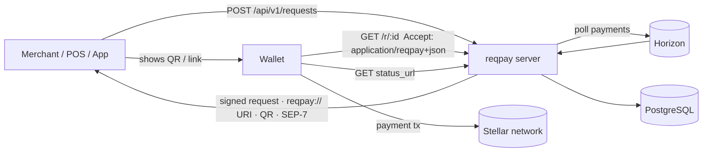

# stellar-reqpay

**Open Request-to-Pay protocol for Stellar wallets, merchants and applications.**

[](https://github.com/StellarOpenInfrastructure/stellar-reqpay/actions/workflows/ci.yml)
[](https://github.com/StellarOpenInfrastructure/stellar-reqpay/actions/workflows/security.yml)
[](LICENSE)
[](docs/protocol/REQPAY-1.md)
[](docs/drips-wave.md)

> A versioned, signed, expiring payment request that any wallet can scan, pay
> and track — with a SEP-7 fallback for wallets that only speak `web+stellar:`.

---

## Problem

Merchants and apps ask for Stellar payments with ad-hoc QR codes or SEP-7
links. Those carry destination, amount and memo — but not _when the request
expires_, _who issued it_, _what it is for_, or _whether it has been paid_.
Every point-of-sale, invoicing tool and wallet re-invents matching payments to
requests.

## Solution

**REQPAY/1** ([spec](docs/protocol/REQPAY-1.md)) defines:

- a strict **request document** with `id`, `destination`, `asset`, optional
  `amount` (open-amount supported), `memo`, `expires_at`, `merchant`,
  `reference`, `metadata`, `status_url`, `return_url`;
- **canonical JSON + Ed25519 signatures** verifiable against the merchant's
  `stellar.toml` `URI_REQUEST_SIGNING_KEY`;
- three transports: self-contained `reqpay://` URI (QR/NFC), hosted
  `https://…/r/{id}` link (`application/reqpay+json`), and SEP-7 downgrade;
- a **status document** (`pending · underpaid · paid · expired · cancelled`)
  with attributed on-chain payments.

This repository ships the **SDK** (schema, canonical encoding, signing, URI,
QR, status derivation, payment matching) and a **reference server** that
issues requests, serves hosted links, watches Horizon for payments and
exposes status.

## Why Stellar

- Memos and muxed accounts give cheap, native request-to-payment correlation.
- Sub-second finality and low fees suit point-of-sale flows with short
  expirations.
- SEP-7 and `stellar.toml` already establish wallet URI handling and merchant
  key discovery; REQPAY builds on them rather than replacing them.
- SEP-41 tokens on Soroban are first-class: `asset: "contract:C…"`.

## Architecture



### Stellar infrastructure consumed

| Component      | Uses                                       | Why                                                                                               |
| -------------- | ------------------------------------------ | ------------------------------------------------------------------------------------------------- |
| SDK            | `@stellar/stellar-sdk` `Keypair` (Ed25519) | signatures                                                                                        |
| server watcher | **Horizon** `/accounts/{dest}/payments`    | classic payments to an account are indexed by Horizon; RPC does not serve account payment history |
| roadmap        | Stellar RPC `getEvents`                    | SEP-41 `transfer` events for `contract:` assets                                                   |

## Features

- ✅ REQPAY/1 schema with strict validation (Zod)
- ✅ Canonical JSON, Ed25519 sign/verify with domain separation
- ✅ `reqpay://` URI encode/decode, hosted links, SEP-7 downgrade
- ✅ QR (SVG / PNG data URL)
- ✅ Status derivation incl. underpaid, expired, cancelled; exact `bigint` amounts
- ✅ Payment matching (destination, asset, memo, expiry) and idempotent attribution
- ✅ Fastify API with OpenAPI, request ids, pagination, `/health`, `/ready`
- ✅ Horizon payment watcher (opt-in polling)
- ✅ PostgreSQL persistence + in-memory mode
- ⏳ Soroban token watcher, webhooks, `stellar.toml` key verification — roadmap

## Repository structure

```
stellar-reqpay/
├── packages/sdk/src/       # @stellar-reqpay/sdk
│   ├── schema.ts           # REQPAY/1 Zod schemas
│   ├── canonical.ts        # canonical JSON + signatures
│   ├── encoding.ts         # reqpay:// URI, hosted link, SEP-7
│   ├── qr.ts
│   └── lifecycle.ts        # status derivation, payment matching
├── backend/src/            # @stellar-reqpay/api
│   ├── service.ts          # request lifecycle
│   ├── watcher.ts          # Horizon payment watcher
│   ├── routes/             # /api/v1/requests, /r/:id
│   └── repository/         # memory + postgres
├── database/migrations/
├── docs/protocol/REQPAY-1.md
├── examples/               # request, status, URI encoding script
├── docs/ (architecture, api, guides, security, adr, drips-wave)
└── Makefile, docker-compose.yml, backend/Dockerfile
```

No `frontend/`: wallets and merchant systems are the UI; a hosted checkout
page is a Drips Wave issue. No `contracts/`: REQPAY is an off-chain protocol.

## Requirements

Node.js ≥ 22, pnpm ≥ 10, PostgreSQL 16 (optional).

## Installation

```bash
git clone https://github.com/StellarOpenInfrastructure/stellar-reqpay
cd stellar-reqpay && make setup && cp .env.example .env
```

## Configuration

| Variable                            | Default                 | Purpose                                               |
| ----------------------------------- | ----------------------- | ----------------------------------------------------- |
| `PUBLIC_BASE_URL`                   | `http://localhost:4030` | hosted link base                                      |
| `REQPAY_SIGNING_SEED`               | unset                   | issuer signing key (S…); unsigned requests when unset |
| `MERCHANT_NAME` / `MERCHANT_DOMAIN` | unset                   | default merchant block                                |
| `DEFAULT_EXPIRY_SECONDS`            | 900                     | request lifetime                                      |
| `WATCH_INTERVAL_SECONDS`            | 0                       | Horizon polling (0 = off)                             |
| `DATABASE_URL`                      | unset → memory          | persistence                                           |

## Development

```bash
make dev            # http://localhost:4030/docs
make test           # SDK + API tests (Postgres test when DATABASE_URL set)
make lint && make typecheck && make build
pnpm exec tsx examples/encode-uri.ts
```

## Testing

- SDK: schema edge cases, canonicalization, signature tamper detection, URI
  round-trip, SEP-7, QR, status derivation, matching.
- API: full lifecycle (create → underpaid → paid, expiry, cancel, duplicate
  attribution), hosted links, OpenAPI.
- Watcher: cursor handling and single attribution with a fake source.
- Postgres repository: integration test (CI service container).

## API

| Method | Path                            | Purpose                                                              |
| ------ | ------------------------------- | -------------------------------------------------------------------- |
| `POST` | `/api/v1/requests`              | create request → view with `links.uri`, `links.hosted`, `links.sep7` |
| `GET`  | `/api/v1/requests`              | list (paginated, filter by status)                                   |
| `GET`  | `/api/v1/requests/:id`          | view                                                                 |
| `GET`  | `/api/v1/requests/:id/status`   | status document                                                      |
| `POST` | `/api/v1/requests/:id/cancel`   | cancel                                                               |
| `POST` | `/api/v1/requests/:id/payments` | attribute an observed payment                                        |
| `GET`  | `/api/v1/requests/:id/qr.svg`   | QR                                                                   |
| `GET`  | `/r/:id`, `/r/:id/status`       | public hosted link (`application/reqpay+json`)                       |

OpenAPI: [docs/api/openapi.json](docs/api/openapi.json).

## SDK

```ts
import {
  parseRequest,
  signRequest,
  encodeUri,
  decodeUri,
  verifyRequest,
  toSep7,
  deriveStatus,
} from "@stellar-reqpay/sdk";

const request = parseRequest({
  v: "REQPAY/1",
  id,
  network,
  destination,
  asset: "native",
  amount: "5",
  created_at,
});
const uri = encodeUri({
  request,
  signature: signRequest(request, issuerKeypair),
  signer: issuerKeypair.publicKey(),
});
// wallet side
const { request: r, signature, signer } = decodeUri(scanned);
if (signature && signer && !verifyRequest(r, signature, signer)) throw new Error("bad signature");
```

## Contracts

Not applicable.

## Deployment

```bash
make docker-up   # api + postgres
```

Generate a dedicated signing key, publish its public key as
`URI_REQUEST_SIGNING_KEY` in `https://<MERCHANT_DOMAIN>/.well-known/stellar.toml`,
and set `PUBLIC_BASE_URL` to the HTTPS origin.

## Security

[SECURITY.md](SECURITY.md) · [docs/security/overview.md](docs/security/overview.md)

## Threat model

| Threat                                 | Mitigation                                                                                        |
| -------------------------------------- | ------------------------------------------------------------------------------------------------- |
| Tampered request (changed destination) | Ed25519 signature over canonical JSON; wallets verify against `stellar.toml`                      |
| Replay of an old request               | `expires_at`; server status `paid`/`expired`/`cancelled`                                          |
| Payment attributed twice               | tx hash uniqueness across all requests                                                            |
| Forged payment webhook                 | `POST …/payments` is for trusted callers only; watcher verifies against Horizon (auth is roadmap) |
| Open redirect                          | `return_url` must be HTTPS                                                                        |
| Guessable ids                          | server generates UUIDs                                                                            |

## Roadmap

1. Soroban token payment watcher (SEP-41 events via RPC)
2. Webhooks with HMAC on status change
3. `stellar.toml` signer verification helper in the SDK
4. Hosted checkout page and wallet reference implementation
5. API-key auth
6. Submit REQPAY/1 as a SEP draft

Backlog: [docs/drips-wave.md](docs/drips-wave.md).

## Contributing

See [CONTRIBUTING.md](CONTRIBUTING.md).

## Drips Wave contribution areas

| Area     | Examples                                         |
| -------- | ------------------------------------------------ |
| Protocol | spec clarifications, test vectors, SEP alignment |
| SDK      | toml verification, browser build, wallet helpers |
| Server   | webhooks, auth, Soroban watcher                  |
| Docs     | wallet and merchant integration guides           |

## License

Apache-2.0.

## Disclaimer

Draft protocol and initial scaffold. Expect breaking changes before REQPAY/1
is frozen.
