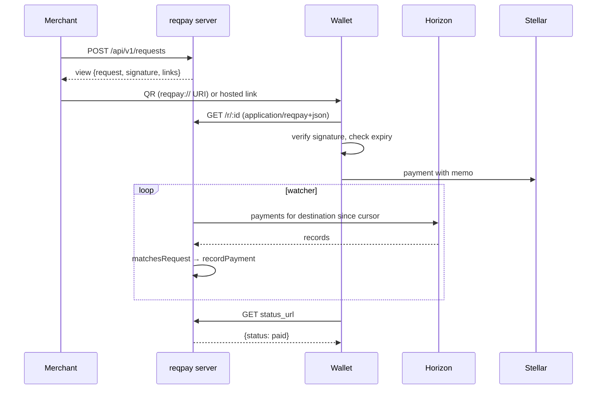

# Architecture

## Layers

- **SDK** — pure functions; no I/O except QR rendering.
- **Service** (`backend/src/service.ts`) — lifecycle rules: creation
  defaults, signature, status refresh, idempotent attribution.
- **Watcher** — polls a `PaymentSource` per destination with cursors.
  Horizon implementation provided; the interface allows RPC/indexer sources.
- **Repository** — in-memory or PostgreSQL.

## Status derivation

Status is derived, never set directly (except `cancelled`):
`deriveStatus(request, payments, {cancelled, now})`. Time-based transitions
(`pending → expired`) are applied lazily on read and persisted.
